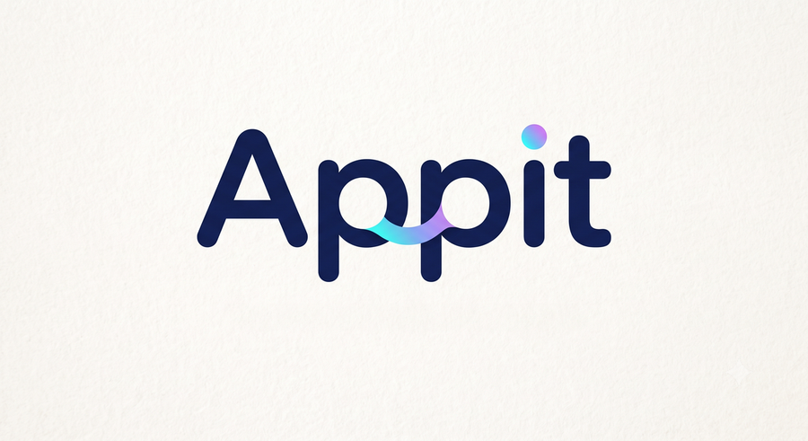
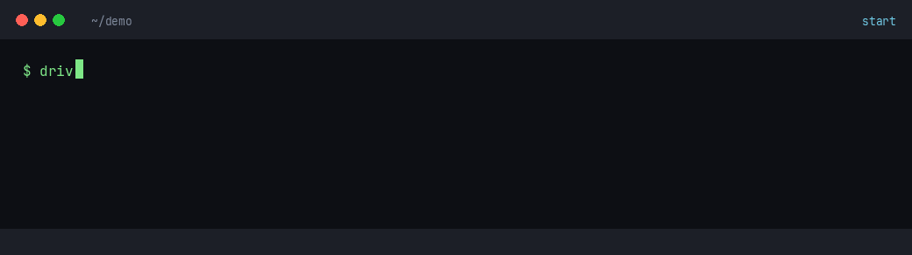

<p align="center">
  
</p>

# Appit skills

Practical agent skills for real engineering work — browser QA, tickets, databases, remote boxes,
CI triage, Blender. One marketplace, twelve skills, no runtime dependencies.

> **This repository contains no skill code.** It is the catalog: one `marketplace.json` that points at
> the nine skill repositories, so a single `claude plugin marketplace add` makes all of them
> installable. The skill code, its README, its demo and its licence live in each skill's own repo
> (listed below), which is also where issues and pull requests belong.

Every skill is plain `SKILL.md` plus (where useful) a single stdlib script, so it works in any agent
that reads the open Agent Skills format: **pi, Claude Code, Codex, Cursor, Gemini CLI, Copilot, Goose**.



<p align="center">
  <a href="https://www.npmjs.com/package/@appitlabs/skills"></a>
  <a href="https://www.npmjs.com/package/@appitlabs/skills"></a>
  
  
</p>

## Install

**Claude Code** — the whole collection as a marketplace:

```bash
claude plugin marketplace add Appit-labs/appit-skills
claude plugin install live-qa@appit-skills
```

**pi** — one package, twelve skills:

```bash
pi install npm:@appitlabs/skills
```

**Codex / Cursor / anything else** — clone and copy the skill you want:

```bash
git clone git@github.com:Appit-labs/live-qa.git
cp -r live-qa/skills/live-qa ~/.codex/skills/          # or ~/.claude/skills/, or .cursor/skills/
```

Verified end to end, not asserted:

```
$ claude plugin marketplace add Appit-labs/appit-skills
✔ Successfully added marketplace: appit-skills
$ claude plugin install live-qa@appit-skills
✔ Successfully installed plugin: live-qa@appit-skills
$ claude plugin details live-qa@appit-skills
  Skills (1)  live-qa      Always-on: ~110 tok   On-invoke: ~2k
```

```
$ npx skills add Appit-labs/live-qa     # installs into .claude/skills, .agents/skills and agent/skills
```

## The skills

| Skill | What it is, in one line | It removes |
| --- | --- | --- |
| [live-qa](https://github.com/Appit-labs/live-qa) | Live QA in a real browser: a numbered screenshot per step, a pass/fail table, console/network facts | "looks good" with no evidence |
| [ci-triage](https://github.com/Appit-labs/ci-triage) | Red CI → the failing step and the four lines that matter (GitHub Actions + GitLab) | reading 10k lines to find one error |
| [pg-inspect](https://github.com/Appit-labs/pg-inspect) | 34 read-only Postgres commands: `audit` health report, plan trees with cost bars, schema drift fingerprint, index/bloat/xid/sequence checks, ERD, `--json/--csv/--md` | retyping `psql` with credentials, one typo from a write |
| [repo-runbook](https://github.com/Appit-labs/repo-runbook) | Writes the install/test/migrate runbook into `AGENTS.md`, and keeps it honest | forty tool calls re-discovering how to run the tests |
| [remote-exec](https://github.com/Appit-labs/remote-exec) | One-shot SSH with hard timeouts, host aliases and a single-call health probe | sessions hanging on a password prompt |
| [trello-tickets](https://github.com/Appit-labs/trello-tickets) | Seven ticket types baked in: sections, checklist, labels, cover colour | half-filled cards and a template to copy by hand |
| [cloud-browser](https://github.com/Appit-labs/cloud-browser) | Hosted browser sessions, plus the sweep that stops orphaned ones | a browser still billing after a crashed run |
| [open-design](https://github.com/Appit-labs/open-design) | The OpenDesign monorepo: pinned pnpm, `tools-dev` lifecycle, QA, pre-PR checks | the corepack/pnpm hour |
| [blender-pipeline](https://github.com/Appit-labs/blender-pipeline) | Blender via MCP: eight playbooks behind one router | loading eight skills to model one prop |
| [code-scan](https://github.com/Appit-labs/code-scan) | Skylos + Fallow as one prioritised report, with a repository baseline gate | two scanners, two severity scales, and a gate nobody can switch on |
| [release](https://github.com/Appit-labs/release) | Conventional commits → SemVer, changelog, release PR/MR, tag, release (GitHub or GitLab) | hand-edited changelogs and version numbers that drift |
| [hermes-setup](https://github.com/Appit-labs/hermes-setup) | Short-lived JWT, least-privilege DB role, 0600 env, three-assertion link check for a Hermes agent | agent tokens that never expire and DB users with too much power |

## Why these

- **Measured, not guessed.** Each skill came out of real work: 16k grep-crawls became `repo-runbook`,
  1,115 retyped `psql` lines became `pg-inspect`. The numbers are in each repo.
- **Token-cheap by design.** Descriptions are short because every skill's description is paid on
  every session; detail lives in `references/` and is read only when needed.
- **Security-scanned.** Each repo carries a SkillSpector baseline and a `SECURITY.md` that lists every
  accepted finding and why. Nothing here shells out with `shell=True`, bundles a credential, or picks
  a network destination at runtime.
- **Verified end to end.** Scripts ship `--self-test`; the commands were run against real targets
  (a live Postgres, a staging server, a failing CI run, Blender through MCP).

## Cost

Every skill's description is injected into every session, so it is kept short on purpose:

| | always-on | on invoke |
| --- | --- | --- |
| `live-qa` | ~110 tok | ~2k |
| `pg-inspect` | ~95 tok | ~0.7k |
| `repo-runbook` | ~87 tok | ~0.9k |

Detail lives in each skill's `references/` and is read only when needed. Installing the whole
collection costs about 830 tokens of session overhead in total.

## License

**MIT**, copyright Appit Labs. Chosen deliberately: it is the licence the Agent Skills
ecosystem defaults to, it puts no friction on internal use inside a company, and it is
compatible with the MIT playbooks bundled in `blender-pipeline`.

| Concern | Why MIT is enough here |
| --- | --- |
| Adoption | one file to read, no notice obligations beyond keeping the copyright line |
| Company use | no "network" or "field of use" restriction to clear with legal |
| Derivative skills | anyone can fork a skill, tune it to their stack, keep it private |
| Patents | no express grant (Apache-2.0 has one); acceptable for instruction + small scripts, revisit if we ever ship a patentable runtime |

`blender-pipeline` redistributes the [Blender Skills](https://github.com/arjun988/blender-skills)
playbooks by arjun988 under their MIT terms — see its `NOTICE`. If a future skill bundles
Apache-2.0 code, that skill will carry its own `NOTICE` and say so in its README.
