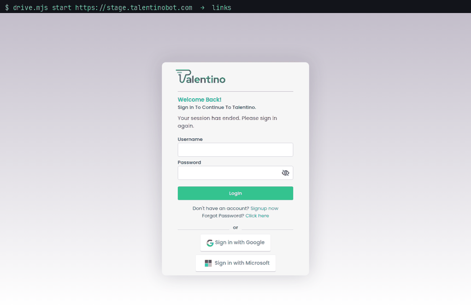

<p align="center">
  
</p>

# Appit skills

Practical agent skills for real engineering work — browser QA, tickets, databases, remote boxes,
CI triage, Blender. One marketplace, nine skills, no runtime dependencies.

Every skill is plain `SKILL.md` plus (where useful) a single stdlib script, so it works in any agent
that reads the open Agent Skills format: **pi, Claude Code, Codex, Cursor, Gemini CLI, Copilot, Goose**.



## Install

**Claude Code** — the whole collection as a marketplace:

```bash
claude plugin marketplace add ibrahimbdr/appit-skills
claude plugin install live-qa@appit-skills
```

**pi** — one package, nine skills:

```bash
pi install npm:@ibrahimbdr/skills
```

**Codex / Cursor / anything else** — clone and copy the skill you want:

```bash
git clone git@github.com:ibrahimbdr/live-qa.git
cp -r live-qa/skills/live-qa ~/.codex/skills/          # or ~/.claude/skills/, or .cursor/skills/
```

Verified end to end, not asserted:

```
$ claude plugin marketplace add ibrahimbdr/appit-skills
✔ Successfully added marketplace: appit-skills
$ claude plugin install live-qa@appit-skills
✔ Successfully installed plugin: live-qa@appit-skills
$ claude plugin details live-qa@appit-skills
  Skills (1)  live-qa      Always-on: ~110 tok   On-invoke: ~2k
```

```
$ npx skills add ibrahimbdr/live-qa     # installs into .claude/skills, .agents/skills and agent/skills
```

## The skills

| Skill | What it does | Needs |
| --- | --- | --- |
| [live-qa](https://github.com/ibrahimbdr/live-qa) | Live QA in a real browser: numbered screenshot per step, pass/fail table, console/network/a11y evidence, plus verified Turnstile/auth procedures | an `agent_browser`-style browser tool |
| [ci-triage](https://github.com/ibrahimbdr/ci-triage) | "CI is red" → failing step + the extracted error, GitHub Actions and GitLab | `gh` and/or `glab` |
| [pg-inspect](https://github.com/ibrahimbdr/pg-inspect) | Read-only Postgres inspection that is safe against production | `psql` |
| [repo-runbook](https://github.com/ibrahimbdr/repo-runbook) | Writes the install/test/migrate runbook into `AGENTS.md` so sessions stop re-grepping for it | Python 3.9+ |
| [remote-exec](https://github.com/ibrahimbdr/remote-exec) | SSH that cannot hang: aliased hosts, hard timeouts, one-call host probe | `ssh` + key auth |
| [trello-tickets](https://github.com/ibrahimbdr/trello-tickets) | Seven ticket types with sections, checklist, labels, cover — read and create | Trello API key |
| [cloud-browser](https://github.com/ibrahimbdr/cloud-browser) | Hosted/stealth browser sessions **and** the sweep that stops them billing | provider key |
| [open-design](https://github.com/ibrahimbdr/open-design) | OpenDesign monorepo: pinned pnpm, `tools-dev` lifecycle, QA, pre-PR checks | Node 24 + pnpm 10.33.2 |
| [blender-pipeline](https://github.com/ibrahimbdr/blender-pipeline) | Blockout → shade → light → export via MCP, eight playbooks behind one router | Blender + MCP add-on |

## Why these

- **Measured, not guessed.** Each skill came out of real work: 16k grep-crawls became `repo-runbook`,
  1,115 retyped `psql` lines became `pg-inspect`. The numbers are in each repo.
- **Token-cheap by design.** Descriptions are short because every skill's description is paid on
  every session; detail lives in `references/` and is read only when needed.
- **Security-scanned.** Each repo carries a SkillSpector baseline and a `SECURITY.md` that lists every
  accepted finding and why. Nothing here shells out with `shell=True`, bundles a credential, or picks
  a network destination at runtime.
- **Verified end to end.** Scripts ship `--self-test`; the commands were run against real targets
  (a live Postgres, a staging server, a failing CI run, Blender through MCP).

## Cost

Every skill's description is injected into every session, so it is kept short on purpose:

| | always-on | on invoke |
| --- | --- | --- |
| `live-qa` | ~110 tok | ~2k |
| `pg-inspect` | ~95 tok | ~0.7k |
| `repo-runbook` | ~87 tok | ~0.9k |

Detail lives in each skill's `references/` and is read only when needed. Installing the whole
collection costs about 830 tokens of session overhead in total.

## License

MIT. `blender-pipeline` bundles the Blender Skills playbooks by
[arjun988](https://github.com/arjun988/blender-skills) (MIT) — see its `NOTICE`.
